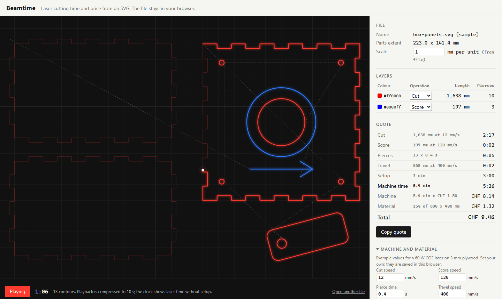

# Beamtime

Laser cutting time and price from an SVG, in the browser.

Drop the SVG you are about to cut. Beamtime reads every shape, groups them by stroke colour (red = cut, blue = score by default), and shows a breakdown: cut length, score length, pierces, travel, setup, machine minutes, material share and total price. Press Play to watch the job in the order the laser would cut it, holes before outlines. "Copy quote" puts the breakdown on the clipboard as plain text.

The file never leaves your browser. There is no server logic, no account and no API key.



## Run it

Requires Node.js 18 or newer. No dependencies to install.

```
npm start      # http://localhost:5173
npm test       # unit tests for geometry and the estimate
```

Then click "load the sample box" or drop your own SVG on the dark area.

## How the estimate works

```
time  = cut length / cut speed
      + score length / score speed
      + pierces x pierce time
      + travel length / travel speed
      + setup
price = machine minutes x rate per minute
      + material (part bounding box + 5 mm margin) / sheet area x sheet price
        (or whole sheets, if "Charge whole sheets" is ticked)
```

- Units come from the SVG `width` / `height` and `viewBox`. Files without units are read as 96 dpi px, and the app says so. The scale can be overridden.
- Transforms (translate, scale, rotate) are applied.
- Each closed shape or path subpath counts as one pierce.
- Default machine values are examples for a 60 W CO2 laser on 3 mm plywood. Set your own; they are saved in localStorage.

Known limits: corner slowdown is not modelled, so detailed parts take longer than estimated. Text, images and `<use>` clones are not counted; the app lists how many it skipped. Raster engraving is not estimated. DXF is not read yet.

## Project layout

```
index.html, styles.css
src/app.js           UI wiring and state
src/svg-sampler.js   SVG -> contours in mm (browser)
src/geometry.js      lengths, layers, cut order (pure)
src/estimate.js      time and price model, quote text (pure)
src/preview.js       canvas preview and playback
samples/             sample box SVG and its generator
test/                node --test
devpost/             scope, PRD, spec and build checklist from the Devpost Learn skill pack
```

## Built with

Made with Claude Code for the Build With AI: Basics hackathon, following the [Devpost Learn skill pack](https://github.com/challengepost/learn-ai-basics). The planning documents (scope, PRD, spec, build checklist) are in `devpost/`.

## License

MIT, see LICENSE.
